# MagicShroom

MagicShroom is a Magic: The Gathering card catalog with personal decks and card comparison. The
backend is a Kotlin/Spring Boot API on Supabase PostgreSQL, deployed to Render; the Android app uses
Jetpack Compose and Supabase Auth.

To test the app, launch it in the Android emulator and wait ~2 minutes for the Render API to spin up before using it.

## What works today

| Area | Status |
|---|---|
| Card catalog | 20,478 cards from the MTGJSON archive in Supabase; the API searches by name and color (the app by name), with paging, card detail, and a batch lookup. |
| Card images | Scryfall scans for 20,473 cards. The app downloads them from Scryfall with its own User-Agent. |
| Card comparison | "Compare with…" on a card lists similar cards (same type, same or overlapping colors, never the card's own other face); the comparison marks mana value, power, toughness, loyalty, and popularity as better, worse, or equal, shows matching colors as equal, and lists keywords, types, and differing colors unique to each card. |
| Sign-in | Google through Supabase Auth; guests can browse, search, and compare without signing in. The API verifies each access token against the project's signing keys and creates the app account on first use. |
| Decks | Full deck API and app screens to create, rename, and delete decks, and add or remove catalog cards. Open My decks from Account. |
| Admin | Users with the `ADMIN` role see Admin tools in the app: list users, change roles, and delete users (including their Supabase login when the server has the admin key). Promote the first admin with SQL; see below. |
| Deployment | GitHub Actions tests every pull request; a push to `main` also publishes the API image to GHCR and asks Render to deploy it. |

## API Endpoints:

Base URL: [magicshroom.onrender.com](https://magicshroom.onrender.com)

- `GET /api/v1/cards`
- `GET /api/v1/cards?page=0&size=10` (paginated)
- `GET /api/v1/cards/{cardId}`
- `GET /api/v1/cards/{cardId}/similar`
- `GET /api/v1/decks`

The Render API takes ~2 minutes to start up after being idle.

## Run it locally (App runs on Render by default)

1. Copy `.env.example` to `backend/.env` and fill in the Supabase values. The backend
   reads the database settings and `SUPABASE_URL`; the app's build reads `SUPABASE_URL` and
   `SUPABASE_PUBLISHABLE_KEY`.
   Set `SUPABASE_AUTH_ADMIN_KEY` to your server-only Supabase secret key in `backend/.env` to enable user deletion (set it in Render's environment when testing the deployed API).
2. Start the API from the repository root:
   ```bash
   set -a && . ./backend/.env && set +a && cd backend && ./gradlew bootRun
   ```
   Alternatively, with Docker running and `backend/.env` filled in, start the container from the repository root:
   ```bash
   docker compose up
   ```
   This builds the backend image and exposes the API at `http://localhost:8080`, using your
   configured Supabase database. Use `docker compose up --build` after backend changes.
3. The app talks to the Render API by default
4. To use
   the API from step 2, build with `./gradlew :app:assembleDebug -PbackendUrl=http://10.0.2.2:8080` or set `backendUrl` in `~/.gradle/gradle.properties`.

- Local Docker API (start `docker compose up` from the repository root first):
  ```bash
  ./gradlew :app:installDebug -PbackendUrl=http://10.0.2.2:8080
  ```
- Deployed Render API (no local backend needed):
  ```bash
  ./gradlew :app:installDebug -PbackendUrl=https://magicshroom.onrender.com
  ```

## Testing

```bash
cd backend && ./gradlew test # (the PostgreSQL test needs Docker)
cd frontend && ./gradlew :app:testDebugUnitTest
```

## Make someone an admin

After the person has signed in once, run in the Supabase SQL editor or `psql`:

```sql
insert into app_users (auth_user_id, email, display_name, role)
select id, email, coalesce(nullif(raw_user_meta_data->>'full_name', ''), split_part(email, '@', 1)), 'ADMIN'
from auth.users where email = 'teammate@example.com'
on conflict (auth_user_id) do update set role = 'ADMIN'
returning id, email, role;
```

## App screenshots

All 13 screenshots are saved in [`docs/screenshots/`](docs/screenshots/).

| Card catalog | Card details | Legalities and rulings |
| --- | --- | --- |
| 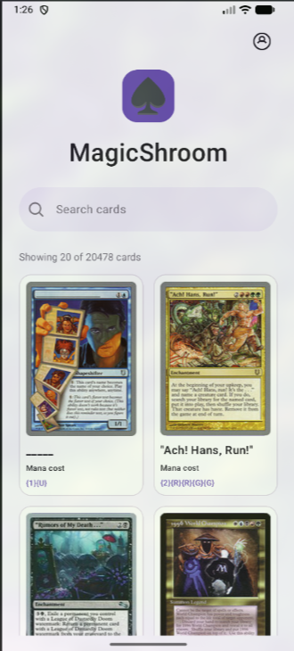 | 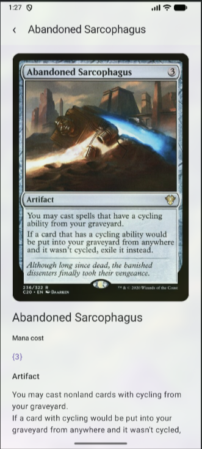 | 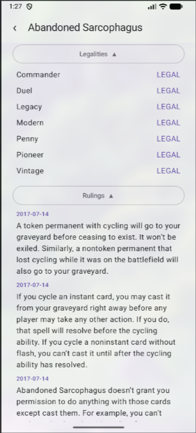 |

| Similar cards | Card comparison | Card search |
| --- | --- | --- |
| 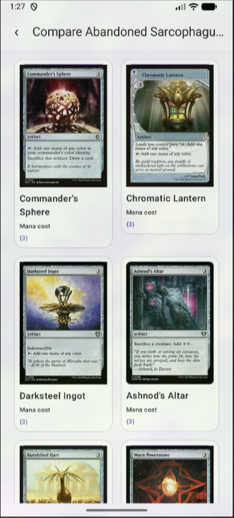 | 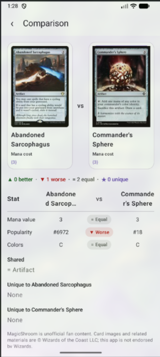 | 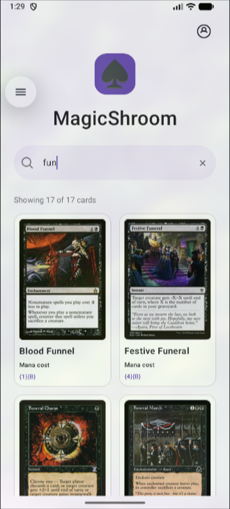 |

| Account | Admin tools | My decks |
| --- | --- | --- |
| 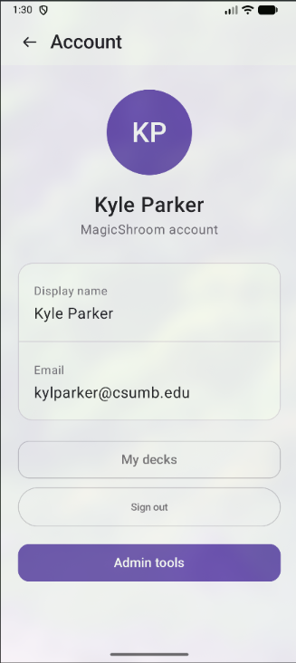 | 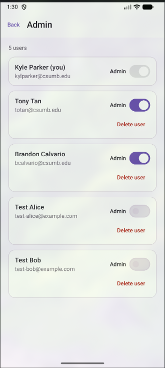 | 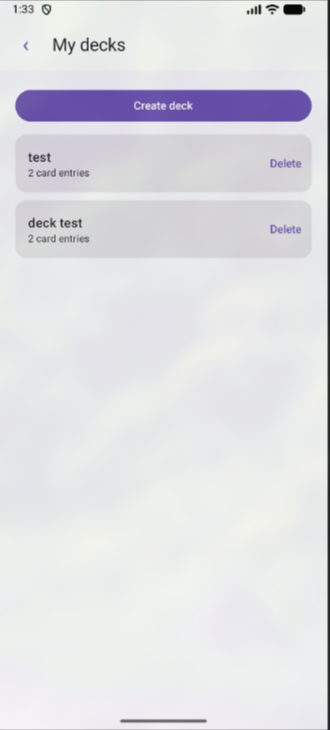 |

| Create deck | Empty deck | Deck cards |
| --- | --- | --- |
| 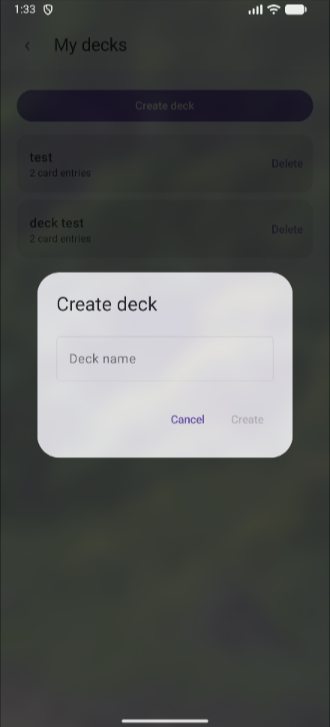 | 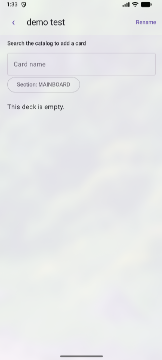 | 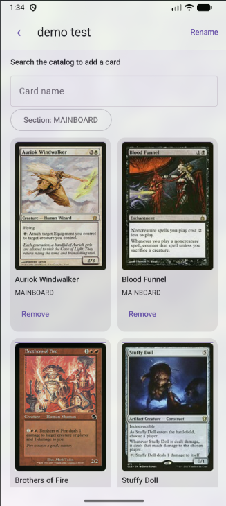 |

| Rename deck |
| --- |
| 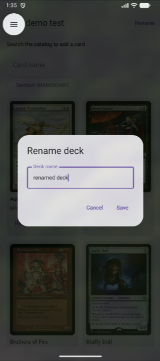 |

## Documentation

- [`backend/README.md`](backend/README.md): API configuration, profiles, tests, and Docker.
- [`frontend/README.md`](frontend/README.md): app configuration, sign-in, screens, and tests.
- [`docs/openapi.yaml`](docs/openapi.yaml): API contract.
- [`docs/supabase-deployment.md`](docs/supabase-deployment.md): Supabase setup, schema, and the one-time card import.
- [`docs/render-deployment.md`](docs/render-deployment.md) and [`docs/CI-RENDER-DEPLOYMENT.md`](docs/CI-RENDER-DEPLOYMENT.md): Render service and the CI deploy (the `RENDER_DEPLOY_HOOK_URL` repository secret must be set for automatic deploys).
- [`docs/superpowers/specs/`](docs/superpowers/specs/): feature designs, such as card comparison.

Database credentials and the Supabase secret key stay on the server. The app only holds the
Supabase publishable key and the signed-in user's access token.
