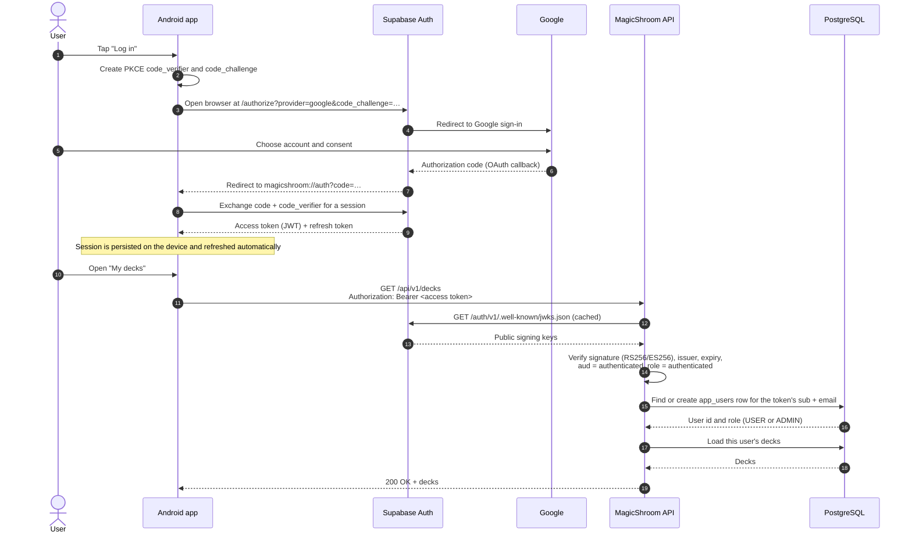
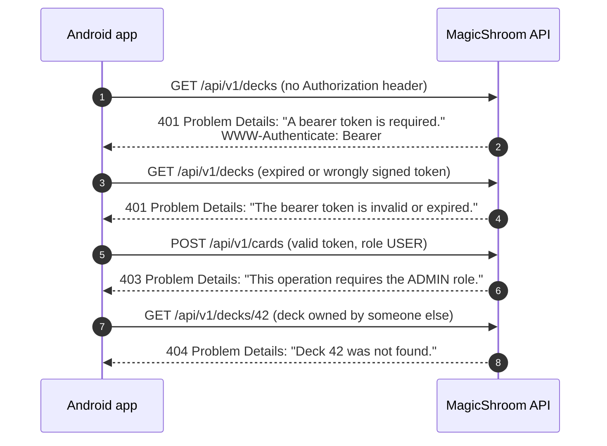

# Authentication sequence

The Android app signs users in with **Google through Supabase Auth** using the OAuth 2.0
authorization-code flow with **PKCE**. The API never sees a password or a Google token: it accepts
a Supabase access token (a signed JWT) as a bearer token and verifies it itself.

## Sign-in and an authenticated request

1. **PKCE** (steps 2–9): the app keeps the `code_verifier` and sends only its hash, so an
   intercepted redirect code is useless without it. The redirect URI `magicshroom://auth` is
   handled by `MainActivity`, and `supabase-kt` performs the code exchange
   (`AppContainer` installs Auth with `flowType = FlowType.PKCE`).
2. **Bearer token** (step 11): `BearerTokenInterceptor` adds the current access token to every API
   request; requests go out without one when nobody is signed in.
3. **Verification** (steps 12–14): `SupabaseSecurity` configures Spring Security as an OAuth 2.0
   resource server. It downloads the project's public keys once and validates every token locally.
4. **Application user** (steps 15–16): `SupabaseCurrentUserResolver` maps the token's `sub` (a UUID)
   to a numeric `app_users.id`, creating the row on first use. The role comes from the database,
   not from the token, so promoting someone to admin takes effect immediately.

## Failure paths

A deck that belongs to another user returns **404, not 403**, so the API does not reveal which deck
IDs exist. If a user's Supabase login has been deleted, a token they still hold is rejected with
`401 "This account no longer exists. Sign in again."` instead of recreating the account.

## Which routes need a token

| Routes | Access |
|---|---|
| `GET /api/v1/cards`, `GET /api/v1/cards/{cardId}`, `GET /api/v1/cards/{cardId}/similar`, `POST /api/v1/cards/batch` | Public |
| `/swagger-ui.html`, `/v3/api-docs`, `/actuator/health` | Public |
| `/api/v1/decks/**`, `GET`/`DELETE /api/v1/users/me` | Any signed-in user (own data only) |
| `POST`/`PUT`/`PATCH`/`DELETE /api/v1/cards/**`, `/api/v1/users`, `/api/v1/users/{userId}` | Signed-in user with the `ADMIN` role |

All error bodies follow the [error model](error-model.md).
