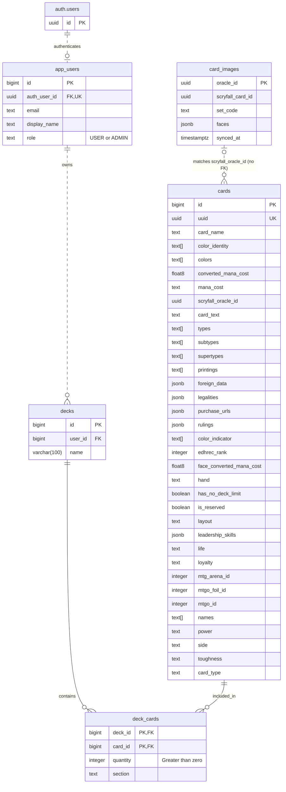

# Entity-relationship diagram

The MagicShroom database schema, as created by the Flyway migrations in
[`backend/src/main/resources/db/migration`](../backend/src/main/resources/db/migration)
(`V1__application_schema.sql`, `V2__required_value_constraints.sql`, `V3__card_images.sql`).
The database is Supabase PostgreSQL; `auth.users` is managed by Supabase Auth, so only its `id` is shown.

## Relationships and delete rules

| Relationship | Cardinality | On delete |
|---|---|---|
| `auth.users` → `app_users` | A Supabase login has at most one application user (`auth_user_id` is unique). | Deleting the login **cascades** to the application user. |
| `app_users` → `decks` | A user owns zero or more decks. | Deleting a user **cascades** to their decks. |
| `decks` → `deck_cards` | A deck contains zero or more card entries. | Deleting a deck **cascades** to its entries. |
| `cards` → `deck_cards` | A card can appear in many decks; `(deck_id, card_id)` is the primary key, so once per deck. | **Restricted**: a card used by a deck cannot be deleted (the API answers `409 Conflict`). |
| `card_images` ↔ `cards` | Matched on `scryfall_oracle_id`; no foreign key, because image metadata is imported separately. | Independent. |

## Constraints worth knowing

- `app_users.role` is `USER` or `ADMIN`; new users start as `USER`.
- `deck_cards.quantity` must be greater than zero; `section` is one of `MAINBOARD`, `SIDEBOARD`, `COMMANDER`, `MAYBEBOARD`.
- V2 rejects blank user, card, and deck names and JSONB card details that are not arrays.
- The `anon` and `authenticated` Supabase roles have no direct access to these tables; only the API's
  server-side connection reads and writes them.
